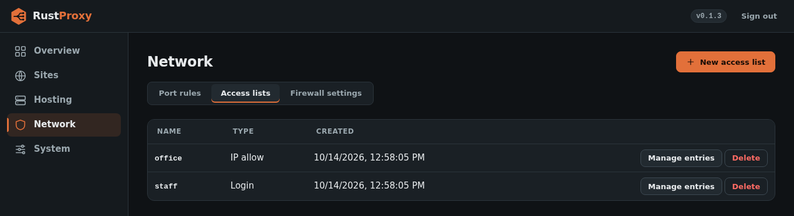
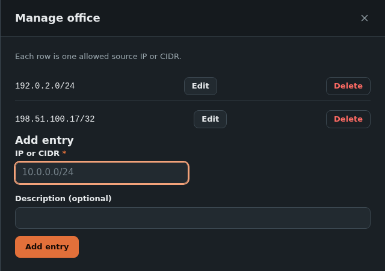

# Access control

Each host can gate who reaches it, at the application layer, on top of
the [firewall](firewall.md). Gates are built from **named, reusable ACLs**.
You create an ACL once, add entries to it, and any number of hosts can
select it. Changing an entry (adding an IP, rotating a password) happens
once, in the ACL, not once per host.

A host selects zero or more ACLs through `acl_ids`. A host with none is
open to everyone.





## ACL kinds

### IP allow

A list of CIDRs (`"10.0.0.0/24"`) or bare IPv4 addresses (treated as
`/32`).

```sh
curl -X POST https://proxy.example.com/api/acls \
  -H "Authorization: Bearer $TOKEN" -H 'Content-Type: application/json' \
  -d '{"name":"office","kind":"ip_allow","ip_entries":["203.0.113.0/28","198.51.100.7"]}'

# add one later
curl -X POST https://proxy.example.com/api/acls/$ID/ip-entries \
  -H "Authorization: Bearer $TOKEN" -H 'Content-Type: application/json' \
  -d '{"cidr":"192.0.2.0/24","description":"branch office"}'
```

### Mobile passes (getting past IP allow lists while mobile)

An IP allow list only lets in the networks it names, which shuts you out
of your own sites from a phone on cellular or a hotel's Wi-Fi. A mobile
pass is the way around that for **your own phone**, without opening the
site to everyone or adding a login page in front of it (a page an app
such as a dashboard client can't get past).

How it works:

1. Turn mobile passes on: **Network > Mobile passes > Accept mobile
   passes** (`PUT /api/mobile-pass {"enabled":true}`). Off by default;
   turning it off refuses every check-in and ends all passes at once.
2. Pick which logins may hold a pass for an IP allow list: open the list
   under **Access lists** and choose its **Mobile pass logins**, a
   [login list](#login) (`PUT /api/acls/:id/mobile-login
   {"login_acl_id":"<login list id>"}`).
3. On the phone, the **RustProxy Mobile Pass** app signs in with one of
   that login list's usernames and passwords. While the app's switch is
   on, the phone's **current** IP counts as inside every IP allow list
   that accepts that login list.

What a pass is, exactly:

- **Only the current IP.** The app checks in every few minutes and the
  moment the phone changes networks. Each check-in *replaces* that
  phone's IP, so the network it just left is no longer let in.
- **Short.** A pass lasts 10 minutes from its last check-in. A phone that
  goes offline, or whose app is switched off without reaching the proxy,
  drops out on its own.
- **Switched off means off.** Turning the app's switch off signs the
  phone out and ends its pass immediately.
- **Nothing remembered.** Passes are held in memory only. No list of past
  IPs is stored, and a restart ends every pass (the app signs in again at
  its next check-in).
- **Changing the login ends it.** Changing or deleting a login in the
  list, deleting the list, or unlinking it from the allow list ends its
  passes immediately.
- **It trusts the address, so keep the site's own sign-in.** While a
  pass is live, *anyone* reaching the proxy from that same public IP is
  treated as inside the allow list, exactly as with an address typed into
  the list. On cellular that IP is usually shared by many of the
  carrier's customers (carrier-grade NAT), and the same goes for hotel
  or café Wi-Fi. Use mobile passes for sites that still ask for their own
  password (a dashboard, an admin page), not as their only protection.
- **Website access only.** A pass satisfies a site's IP allow check, not
  the firewall's port rules or block lists. A blocked IP stays blocked.

The app checks in at `https://<any site on this proxy>/.rust-proxy/mobile-pass`
(`POST {"username","password","device"}` signs in, `DELETE` with the same
body signs out). A wrong password is answered 401 and reported to the SIEM
(`mobile_pass_failure`); 10 failures from one address within 15 minutes
lock that address out of check-ins for the rest of the window (each
attempt is counted before its password is checked, so parallel guesses
don't get extra tries). While
mobile passes are off the path answers 404. The phones holding a pass
right now are listed on the Mobile passes page, which can also end them
all.

### IP and ASN block

A deny list. Entries are single IPs, CIDRs (IPv4 or IPv6) or **AS numbers**
(`AS13238` or `13238`). An AS number expands to every prefix that network
announces, so you can shut out an entire provider with one entry instead of
copying hundreds of ranges by hand.

```sh
curl -X POST https://proxy.example.com/api/acls \
  -H "Authorization: Bearer $TOKEN" -H 'Content-Type: application/json' \
  -d '{"name":"blocked","kind":"ip_block","ip_entries":["AS13238","203.0.113.9","198.51.100.0/24"]}'
```

How ASN entries work:

- Prefixes come from RIPEstat's announced-prefixes data and are stored in
  the database. They are refreshed daily. A failed refresh is retried after
  15 minutes and the last good copy stays in force, so a lookup outage never
  unblocks anything.
- The list's response includes `asn_status` (prefix count, last successful
  fetch, last error per AS), and the Access lists tab shows the same.
- Matching uses an in-memory index, so there is no per-request database work.

**Block always wins.** A visitor on a block list is refused even if they
are in an IP-allow list, hold a login session or present a valid client
certificate. A blocked request gets the "Access denied" page (HTTP 403)
and an `ip_blocked` [SIEM event](logging-and-siem.md); the host's
`deny_fallback` does not apply.

**Per host or global.** Select a block list on a host (`acl_ids`) to block
it there only. To block a list everywhere, mark it global:

```sh
curl -X PUT https://proxy.example.com/api/acls/$ID/global \
  -H "Authorization: Bearer $TOKEN" -H 'Content-Type: application/json' \
  -d '{"global":true}'
```

A global list is dropped before any host is looked up, on every HTTPS and
port-80 listener, and also in the [firewall](firewall.md#block-lists), so it
covers TCP/UDP passthrough, SSH and hosted addresses too. **Do not put your
own management address on a global list.** Only the loopback interface is
exempt, so it would cut your SSH and admin access.

### Login

A list of username and password pairs. A visitor without a valid session
gets a real HTML login page in place of the upstream, rather than an HTTP
Basic Auth prompt, so password managers can offer to save the credential.
A successful login sets a signed, `HttpOnly`, `Secure` session cookie
scoped to that one host; a session for one domain is never accepted on
another. Passwords are hashed with argon2 when the ACL is created and are
never stored or returned in plaintext.

```sh
curl -X POST https://proxy.example.com/api/acls \
  -H "Authorization: Bearer $TOKEN" -H 'Content-Type: application/json' \
  -d '{"name":"staff","kind":"login","credentials":[{"username":"alice","password":"..."}]}'
```

### Client certificate

A client-certificate ACL lets a visitor who presents a valid client
certificate skip the login page. Add the allowed certificate subjects with
`POST /api/acls/:id/client-cert-entries`, body `{"subject","description"}`.
A verified certificate passes only if its subject is listed. **A list with
no entries trusts no certificate.**

> **Current limitation:** the client-certificate verifier trusts a single
> built-in root, the JPPS TrustBridge CA. It is not yet configurable, so
> this kind is only useful if you use TrustBridge.

**Revocation.** Besides the chain and expiry, each certificate is checked
against TrustBridge's OCSP responder (`https://ocsp.pki.jpps.us` by default;
set `RUST_PROXY_OCSP_URL` to change it, or to an empty value to turn the
check off). A revoked certificate is treated as if the visitor had presented
none, so the host falls back to its login page and no identity headers are
forwarded. If the responder cannot be reached, the certificate is allowed
(fail open) and the check is retried shortly after. A revocation, once seen,
is remembered in the database and stays in force even if the responder later
fails to answer.

**Issuing and revoking.** System, Client certificates connects the proxy to
your TrustBridge organization (the organization token is write-only and
never shown again). From there an admin can see the organization's tier and
usage, issue a certificate (the key and `.p12` file are shown once and never
stored) and revoke one, which takes effect immediately. The same actions are
available as `GET/PUT /api/trustbridge`, `GET/POST /api/trustbridge/certs`
and `POST /api/trustbridge/certs/:serial/revoke` (writes are admin only).

**Organization lock.** Set "Require my organization"
(`required_org_id` on `PUT /api/trustbridge`; an empty string removes it) and
only certificates carrying that organization id are honored anywhere: ACL
matching, the identity headers passed to backends, and admin certificate
login. Certificates without it, such as older CN-only ones or ones from
another organization, are treated as if the visitor presented none, and the
site falls back to its login page. The proxy forwards the certificate's
organization and id as `X-Client-Cert-Org` and `X-Client-Cert-Org-Id`.

If you want to hand the verified subject to your upstream (so an app can
skip its own login), turn on a host's `pass_client_cert_header` and set
the top-level `client_cert_forward_token` in `config.toml`
(`openssl rand -hex 32`). The proxy then sends `X-Client-Cert-Subject`
plus `X-RustProxy-Client-Cert-Token`. The upstream must check that **both**
are present and the token matches, otherwise a process that can reach the
upstream directly could forge the subject header. With no token
configured, the option does nothing.

## How the gates combine

For a host that selects ACLs, a visitor gets through if **any** of these
is true:

1. Their source IP is in a selected IP-allow list, or holds a
   [mobile pass](#mobile-passes-getting-past-ip-allow-lists-while-mobile)
   for one.
2. They presented an accepted client certificate (client-cert ACL selected).
3. They hold a valid login session (login ACL selected), after the login page.

In other words IP allow, client cert and login are alternatives (OR), not
a chain. The common pattern is IP allow plus login: people on the trusted
network walk straight in, everyone else sees the login page. A block list
is not part of this OR: it is checked first and overrides all of them.

What a visitor who fails every gate sees depends on what is selected:

| Selected | A visitor who does not match |
|----------|------------------------------|
| IP allow only | The "Access denied" page (HTTP 403), or the host's [`deny_fallback`](deny-fallback.md) if one is set |
| Login (with or without IP allow) | The login page. Login always takes precedence over `deny_fallback` |

Several lists of the same kind combine by union: any selected IP list's
range is enough, and any selected login list's credentials work.

Deleting an ACL that a host still selects is refused (HTTP 409). Remove
it from every host first.

## Port rules

A port rule (TCP/UDP passthrough) can also select ACLs, but only IP-allow
and IP-block lists have any effect there. A block list drops that rule's
traffic from the listed sources in the firewall. A login list is accepted but contributes
nothing, because passthrough has no HTTP layer to show a login page on.
Passthrough produces no application-level events either.

## Denials are logged

Refused requests are emitted as `acl_ip_denied`, `ip_blocked` and `host_login_failure`
events when [SIEM forwarding](logging-and-siem.md) is on.
