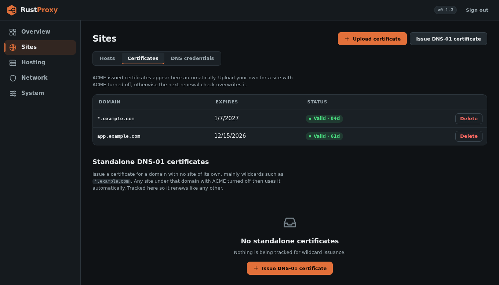
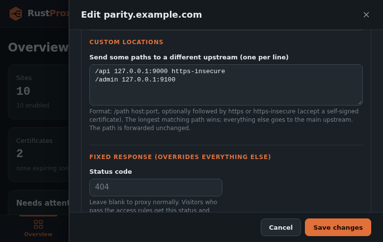

# Configuration

rust-proxy has two layers of configuration:

- **`/etc/rust-proxy/config.toml`**: daemon-level settings (admin listener, ACME paths, network limits, SIEM, optional admin identity). Read at startup.
- **The sqlite database** (`admin.db_path`): hosts, port rules, ACLs, DNS credentials, API tokens, certificates. Managed from the admin UI or the [API](api.md), and applied live with no restart.

`hosts` and `port_rules` in `config.toml` only **seed an empty database on
first boot**. After that, editing them in the file does nothing. If
`config.toml` does not exist, the daemon writes the contents of
`deploy/config.toml.example` to that path, so even a hand-copied binary
starts with a working default.

The shipped example file is heavily commented. This page explains the
parts you are most likely to change.

## `config.toml`

### `[admin]`

| Key | Default | Meaning |
|-----|---------|---------|
| `bind_ip_v4`, `bind_ip_v6`, `bind_port` | `0.0.0.0`, `::`, `8084` | Where the admin UI and API listen. At least one of the two IPs must be set. |
| `allowed_ips` | `[]` (anyone) | Source IPs/CIDRs allowed to reach the admin port. Enforced in nftables, not just in the app. **Set this**, either here or in the first-run wizard / Network, Firewall settings. A non-empty list here wins over the one saved in the database. |
| `expose_admin_port` | `true` | `false` removes the firewall accept rule for the admin port entirely, so it is reachable only over loopback (for example an SSH tunnel). |
| `db_path` | `/var/lib/rust-proxy/rust-proxy.db` | The sqlite database. |

#### Admin identity in `config.toml`

By default the owner account is created by the first-run wizard and
stored in the database. The owner is always an admin and can never be
locked out by a role change. Further accounts with the `operator` or
`viewer` role are added in the web UI's Users tab (see
[Users and roles](users-and-roles.md)). If you would rather keep the owner in the file, set all
three of these together (a partial set is rejected at startup):

```toml
[admin]
session_secret      = "..."   # openssl rand -hex 32
admin_username      = "admin"
admin_password_hash = "..."   # rust-proxy hash-password 'your-real-password'
```

Whatever you set in `config.toml` takes precedence over what the wizard
or UI stored, on every read, not just at first boot.

### `[acme]`

| Key | Meaning |
|-----|---------|
| `cert_dir` | Where certificates are written, one subdirectory per domain. Reloaded from here at startup, so a restart never re-issues. |
| `account_key_path` | The ACME account key. |
| `contact_email` | ACME account contact. Also editable in the UI unless set here. |
| `dns_provider`, `dns_api_token` | Optionally seed a single "default" DNS credential from the file instead of the UI. |
| `renew_before_days` | Renew when a certificate is within this many days of expiry. |
| `organization`, `organizational_unit` | Requested in every CSR Subject. Public CAs such as Let's Encrypt ignore Subject fields beyond the SAN list, so this mainly matters against a private ACME CA that vets organizations. |

Renewals are checked every 12 hours.

### `[network]`

`bind_ranges` is optional and empty by default, meaning "bind to
whatever address this host has". Whether that is one IP, a routed /29,
or several disjoint ranges, it just works. Populate it only if you want
a typo in a `bind_ip` caught at validation time against a range you
control.

### `[siem]`

See [Logging and SIEM](logging-and-siem.md).

### `client_cert_forward_token`

Top-level key, `config.toml` only. Required for a host's "forward
verified client-cert subject to upstream" option to do anything. See
[Access control](access-control.md#client-certificate).

## Hosts

A host maps a domain and a bind address to a destination. These are the
fields of `POST /api/hosts` (and the UI's host form). Required: `domain`, `bind_port`, at
least one of `bind_ip_v4`/`bind_ip_v6`, and one destination (`upstream`,
`redirect` or `static_root`).

| Field | Default | Meaning |
|-------|---------|---------|
| `domain` | | Exact name, or a single leading wildcard label (`*.example.com`). An exact match always wins over a wildcard. |
| `bind_ip_v4`, `bind_ip_v6` | | Address to listen on. **At least one is required.** Use `0.0.0.0` (and `::` for IPv6) to listen on every address, or a specific IP when the host has several. |
| `bind_port` | | Usually `443`. Any port works, for example `8444`. |
| `upstream` | | `host:port` of the internal service. |
| `upstream_https` | `false` | Set `true` if the upstream speaks TLS. |
| `upstream_tls_verify` | `true` | Check the upstream certificate against the bundled Mozilla roots. `false` accepts a self-signed certificate (still encrypted, not authenticated). |
| `upstream_preserve_host` | `true` | Forward the client's original `Host` header. `false` sends the upstream's own `host:port` instead. |
| `websockets` | `false` | Allow WebSocket upgrades through. |
| `force_https` | `true` | Redirect plain HTTP on port 80 to HTTPS. |
| `acme_enabled` | `true` | Issue and renew a certificate automatically. |
| `acme_challenge_type` | `auto` | `auto`, `http01` or `dns01`. See below. |
| `dns_credential_id` | unset | Which DNS credential to use for dns-01. Optional if exactly one exists. |
| `acl_ids` | `[]` | Named [ACLs](access-control.md) this host selects. |
| `deny_fallback` | unset | See [deny_fallback](deny-fallback.md). |
| `locations` | `[]` | Route path prefixes to other upstreams. See [Custom locations](#custom-locations). |
| `hsts` | `false` | Send `Strict-Transport-Security: max-age=63072000` (two years) on every HTTPS response. See [HSTS](#hsts). |
| `hsts_subdomains` | `false` | Add `includeSubDomains` to the HSTS header. Needs `hsts`. |
| `block_exploits` | `false` | Refuse common probe requests. See [Block common exploits](#block-common-exploits). |
| `fixed_response` | unset | Answer every request with a fixed status and body, no upstream needed. See [Fixed-response hosts](#fixed-response-hosts). |
| `redirect` | unset | Make this a redirect host instead of a proxy. |
| `static_root` | unset | Serve files from a local directory instead of proxying. |
| `path_rewrite` | unset | Rewrite the request path before forwarding. |
| `rewrite_samesite_none_cookies` | `false` | Downgrade `SameSite=None` on upstream `Set-Cookie` headers to `Lax`. |
| `pass_client_cert_header` | `false` | Forward the verified client-cert subject to the upstream. |
| `enabled` | `true` | Turn a host off without deleting it. |

Requests to the upstream carry `X-Forwarded-For` (appended to, not
replaced), `X-Forwarded-Proto` and `X-Forwarded-Host`.

### ACME challenge types

- **`auto`** (the default) tries dns-01 first, and if that fails for any reason retries once with http-01. dns-01 depends only on a working DNS credential, not on port 80 being reachable for that exact domain, so it is the more reliable first choice. Port 80 stays open for `auto` hosts so the fallback can work.
- **`dns01`** and **`http01`** force one or the other, with no fallback.
- A **wildcard** (`*.example.com`) always uses dns-01, because CAs never offer http-01 for wildcards. Its bare apex (`example.com`) is automatically added as a second name on the same certificate.
- `http01`, or `auto` without `force_https`, opens a port-80 listener and firewall rule for that host to answer the challenge.



### Standalone wildcard certificates

A wildcard certificate does not need a host. `POST /api/dns01-certs`
with `{"domain","dns_credential_id"}` issues one and tracks it for
renewal. Any subdomain host created afterwards works with `acme_enabled`
off, because SNI dispatch falls back from an exact match to a covering
`*.parent` certificate. Issuance runs synchronously in the request, DNS
propagation wait included, so allow up to a minute.

### Your own certificate

Set `acme_enabled = false` and upload one with `POST /api/certs`
(`{"domain","fullchain_pem","private_key_pem"}`). The upload is rejected
while a host for that domain still has `acme_enabled = true`, since the
next renewal would overwrite it.

### Redirect hosts

```json
{ "domain": "old.example.com", "bind_ip_v4": "0.0.0.0", "bind_port": 443,
  "redirect": { "target": "https://new.example.com", "preserve_path": true, "status": "permanent" } }
```

`target` must be an absolute `http://` or `https://` URL. `preserve_path`
(default `true`) appends the visited path and query. `status` is
`permanent` (301, default) or `temporary` (302). A redirect host still
gets its own certificate and ACL selection.

### Static hosts

`static_root` serves files from a local directory (with an `index.html`
fallback and a path-traversal guard). The directory must exist when you
save the host. `fixed_response` is checked first, then `redirect`, then `static_root`, then
`upstream`.

### Custom locations

```json
{ "upstream": "10.0.0.10:3000",
  "locations": [
    { "path": "/api", "upstream": "10.0.0.20:8080" },
    { "path": "/files/", "upstream": "10.0.0.30:443", "upstream_https": true, "upstream_tls_verify": false }
  ] }
```

A request goes to the location with the longest matching prefix, and
anything that matches none uses the host's own `upstream`. Matching is on
whole path segments: `/api` matches `/api` and `/api/users`, not
`/apiary`. A prefix ending in `/` matches everything beneath it. The path
is forwarded unchanged. Each location carries its own `upstream_https` and
`upstream_tls_verify`. A path must start with a single `/` and may not be
`/` itself (that is the host's `upstream`), or contain `//`, `\`, `?`, `#`,
whitespace or `..`. At most 64 locations per host, no duplicates. In the UI
this is the "Custom locations" box in the Advanced section, one
`/path host:port [https|https-insecure]` per line.



### Block common exploits

`"block_exploits": true` refuses, with a 403 and an `exploit_blocked`
SIEM event, requests that use `TRACE` or `TRACK`, that carry directory
traversal, script-injection, SQL-injection, PHP-injection or
`${jndi:` patterns in the URL (decoded twice, case-insensitive), or that
identify as a well-known scanner (sqlmap, nikto, nessus, wpscan and
similar). It runs before access control. It is a coarse filter for
internet-facing hosts, not a web application firewall, and an app that
legitimately receives such strings in URLs should leave it off.

### Fixed-response hosts

```json
{ "domain": "unused.example.com", "bind_ip_v4": "0.0.0.0", "bind_port": 443,
  "fixed_response": { "status": 404, "body": "Nothing here." } }
```

Add `"html": true` to serve the body as an HTML page (`text/html`, with
`X-Content-Type-Options: nosniff`) instead of plain text. That is how you
**park a site**: point the DNS at the proxy now, give the host a
`fixed_response` with a "Coming soon" page, and replace it with a real
upstream when the site is ready.

```json
{ "domain": "new.example.com", "bind_ip_v4": "0.0.0.0", "bind_port": 443,
  "fixed_response": { "status": 200, "html": true,
                      "body": "<h1>Coming soon</h1><p>We are almost ready.</p>" } }
```

In the site form this is the "Message or landing page" box with a "Serve as an
HTML page" checkbox. The page is served exactly as written, so only paste
HTML you trust.

Every request that passes the ACL gate gets this status (200 to 599) and a
`text/plain` body of up to 64 KiB, and no upstream is needed. This is the
equivalent of NPM's 404 Host: put it on a name you want to answer
deliberately, or on a wildcard so unknown subdomains get a clean 404.
Statuses 204, 205 and 304 take no body.

In the admin UI, **Hosts, Add 404 host** opens the site form with a 404
response already filled in. You only need a domain (and a certificate, which
is issued automatically as for any site). For a catch-all, use a wildcard
such as `*.example.com`: an exact site always wins over the wildcard, so
only subdomains with no site of their own get the 404.

A request for a hostname that matches no site at all (for example a bare IP
address or a domain nobody configured) is answered by the
[Default site](#default-site) setting.

### HSTS

`hsts` makes every HTTPS response from the host carry
`Strict-Transport-Security: max-age=63072000` (two years), which tells
browsers to refuse plain HTTP for that name. `hsts_subdomains` adds
`includeSubDomains`, so the rule covers every subdomain too: only turn it on
if all of them serve HTTPS. The `preload` flag is deliberately not sent
(NPM adds it), because preload-list inclusion is very hard to undo; add it
yourself in the upstream if you have submitted the domain. Turn HSTS on only
after you have confirmed the site works over HTTPS, since browsers remember
it for the full period.

### Default site

**System, Default site** (or `GET`/`PUT /api/default-site`, admin only)
chooses what a request gets when its hostname matches no site. This is NPM's
Settings, Default Site.

| `mode` | Result |
|--------|--------|
| `not_found` (default) | An empty `404` |
| `congratulations` | A short "rust-proxy is running" page |
| `no_response` | The connection is dropped without a reply (like NPM's 444) |
| `redirect` | A redirect to `redirect_url` (an `http://` or `https://` URL) |
| `custom_html` | Your own page from `custom_html` (up to 64 KiB) |

It applies on plain HTTP (port 80) and on HTTPS for names that have a
certificate. A TLS connection to a name rust-proxy holds no certificate for,
or to a bare IP address with no server name, is refused during the handshake,
before any page can be sent, so those visitors see a browser certificate
error rather than the default site. A `*.example.com` fixed-response host
still customises the answer for one domain.

### Commercial license

The About page has an optional field for a Commercial License key from
store.jpps.us. Saving it checks the key once with the store and, if valid,
shows "Commercial usage authorized" with the licensee and expiry. The key is
stored (shown only as its last six characters) and is never re-checked, so
nothing breaks if the store is unreachable later. It is a record, not a
gate: rust-proxy works the same with or without it. `GET`, `PUT` (admin)
and `DELETE` (admin) on `/api/license`; set `RUST_PROXY_LICENSE_SERVER` to
point validation at a different store.

### Path rewrite

```json
{ "path_rewrite": { "pattern": "^/((?:jpps|kb9gxk)/[^/]+)/?$", "replacement": "/$1/-/wikis/Home" } }
```

`pattern` is a Rust `regex` expression matched against the path (not the
query string); `$1`, `$2`... in `replacement` refer to its capture
groups. A path that does not match is forwarded unchanged. The pattern is
validated when you save. Two sharp edges: the regex engine has no
lookahead, and an overly broad pattern (for example "any two-segment
path") will also match the upstream's own assets and API paths. Anchor to
an explicit list of the values you mean.

## DNS providers

Pick the provider when you add a credential in the admin UI. The UI shows
one box per field below and packs them into the single credential string
the backend stores. If you set a credential in `config.toml`
(`acme.dns_provider`, `acme.dns_api_token`), Namecheap and Route53 take
their fields joined with colons in the order shown.

| Provider | `dns_provider` | What you enter |
|----------|----------------|----------------|
| Cloudflare | `cloudflare` | One API token with Zone:DNS:Edit on the zone (Bearer token). |
| DigitalOcean | `digitalocean` | One personal access token with write scope (Bearer token). |
| Hetzner | `hetzner` | One token from the Hetzner DNS Console (`Auth-API-Token` header). |
| DuckDNS | `duckdns` | One token from your DuckDNS account page. The domain must be a DuckDNS subdomain. |
| GoDaddy | `godaddy` | One Personal Access Token (Bearer). The older `sso-key` key/secret scheme is not supported. |
| Namecheap | `namecheap` | Three fields: API user, API key, and the client IP you have allowlisted in Namecheap's API settings. Stored as `user:key:clientip`. |
| Route53 (AWS) | `route53` | Two fields: access key ID and secret access key. Stored as `access_key_id:secret_access_key`, signed for us-east-1. |

A host with a dns-01 challenge picks a credential by `dns_credential_id`.
If exactly one credential exists, hosts that do not name one use it.

Adding a provider is one new file under `src/acme/dns01/` implementing
the `DnsProvider` trait (`find_zone`, `create_txt_record`,
`delete_txt_record`) plus a new `DnsProviderKind` variant. Pull requests
are welcome.
