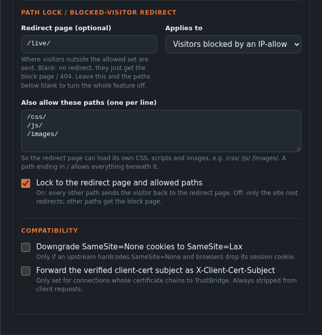

# deny_fallback

`deny_fallback` is a per-host setting that replaces the plain block page
with something more useful. It covers three situations that are awkward to
solve otherwise:

- **A mostly-private site with one public page.** Let everyone see `/live/`, and keep the rest behind an IP allow list.
- **A port that must only ever serve one path**, such as a captive-portal port that should expose `/guest/` and nothing else.
- **A pure path allow-list** with no redirect at all.

It works on any host and is configured in the UI's host form or as the
`deny_fallback` object on `POST /api/hosts` and `PUT /api/hosts/:id`.



## Fields

| Field | Default | Meaning |
|-------|---------|---------|
| `scope` | `blocked` | Who it applies to. `blocked`: only visitors who fail the host's IP-allow ACL. `everyone`: every visitor, ACL or not, applied before the ACL check. |
| `redirect_path` | `""` | A same-site path (single leading `/`) to send visitors to, for example `/live/`. Always reachable. Empty means no redirect: only `allow_paths` are reachable. |
| `lock` | `false` | `false`: visitors are redirected only when they request the site root (or the bare redirect path). `true`: every other GET/HEAD path redirects back to `redirect_path`. |
| `allow_paths` | `[]` | Extra paths visitors may load as-is, so the redirect page can fetch its own CSS, JS and images. |

At least one of `redirect_path` or `allow_paths` must be set. Paths must
be plain: they start with a single `/` (not `//`) and contain no
backslash, `?`, `#`, whitespace or control characters. This is enforced when you save, because
an unchecked redirect path would be an open-redirect risk.

### Matching `allow_paths`

- An entry ending in `/` (such as `/css/`) matches everything beneath it.
- An entry without a trailing slash (such as `/js`) matches that exact path and anything under `/js/`.
- A request path containing `..`, `%2e`, `%2f` or `%5c` never matches, so traversal tricks cannot reach into an allowed prefix.

## What a visitor gets

For a visitor the setting applies to, the request is decided in this
order:

1. **Path is allowed** (the redirect page itself or an `allow_paths` match): the request goes through to the upstream as normal.
2. **No `redirect_path` set:** refused.
3. **Method is not GET or HEAD:** refused. Other methods are never redirected.
4. **Path is `/`, the bare redirect path (`/live`), or `lock` is on:** redirected to `redirect_path`.
5. **Anything else:** refused.

"Refused" depends on scope. With `scope: blocked` it is the normal 403
"Access denied" page. With `scope: everyone` it is a plain `404 Not found`,
so nothing about the upstream is revealed.

`scope: blocked` only has effect on a host that selects an IP-allow ACL
and **no login ACL**. If the host has a login ACL, non-matching visitors
see the login page, and that wins. A visitor who passes the ACL is
unaffected by `blocked` scope.

## Example 1: public live page, private admin

A DMR hotspot dashboard where the live caller view is public and the
admin pages need an allowed network. The host selects an IP-allow ACL for
the home network.

```json
{
  "domain": "hotspot.example.com",
  "bind_ip_v4": "0.0.0.0",
  "bind_port": 443,
  "upstream": "10.0.0.50:80",
  "acl_ids": ["<ip-allow acl id>"],
  "deny_fallback": {
    "scope": "blocked",
    "redirect_path": "/live/",
    "lock": true,
    "allow_paths": ["/css/", "/js/", "/images/", "/fonts/", "/mmdvmhost/live_caller_backend.php"]
  }
}
```

Visitors on the home network see the whole dashboard. Everyone else is
sent to `/live/`, and with `lock` on, any other URL they try bounces back
there. The `allow_paths` entries are the assets and one backend endpoint
the live page needs in order to render and update.

## Example 2: one path on one port

A guest portal port that must serve `/guest/` and nothing else, to
everyone:

```json
{
  "domain": "guest.unifi.example.com",
  "bind_ip_v4": "0.0.0.0",
  "bind_port": 8444,
  "upstream": "10.0.0.20:8444",
  "upstream_https": true,
  "deny_fallback": { "scope": "everyone", "allow_paths": ["/guest/"] }
}
```

There is no `redirect_path`, so this is a pure allow-list. A request to
`/guest/portal/index.html` reaches the upstream. A request to `/manage`
gets `404 Not found`, and never touches the upstream.

## Finding the right `allow_paths`

For a redirect page that loads resources, open the page in a browser with
the developer tools network tab visible and list every path it fetches.
Add each prefix to `allow_paths`. If the page renders unstyled or a widget
stays empty, a missing prefix is almost always the reason; the failed
(redirected or refused) requests in the browser's network tab show which
one.

## Notes

- `lock` only matters when a `redirect_path` is set.
- The redirect target is always a same-site path, never an external URL. To send visitors to another site, use a [redirect host](configuration.md#redirect-hosts).
- Denials from `deny_fallback` that end in a refusal are reported to SIEM as `acl_ip_denied` (for `blocked` scope). Redirects are not logged as denials.
