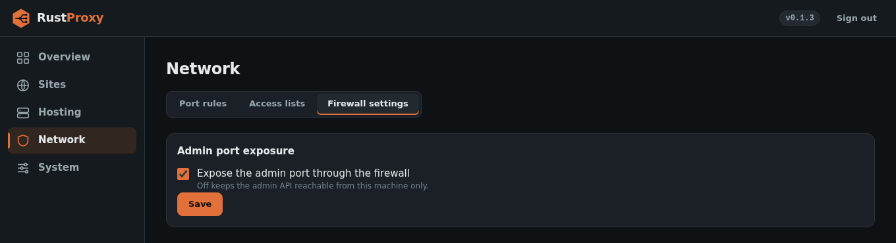
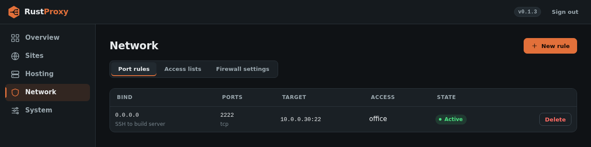

# Firewall

rust-proxy manages an nftables table so that only what you configured is
reachable. On every change to hosts or port rules it regenerates an
`inet` table from scratch: **default DROP**, with one explicit ACCEPT per
active host and port rule.

It needs `CAP_NET_ADMIN` for this (the packaged systemd unit grants it).
Only its own table is touched; other tables on the host are left alone.

## Always open

A small fixed set of ports is accepted regardless of what is configured,
so a fresh install can never lock you out of the access you need to set
it up:

| Port | Why |
|------|-----|
| **22** (SSH) | A separate daemon this project knows nothing about. An install with zero rules must not cut off the way you configure it. |
| **80** and **443** | The ports the proxy exists to serve. Per-host rules add narrower, bind-IP-scoped accepts on top, but a host that is not fully configured yet must not leave these unreachable. |
| **the admin port** (default 8084) | Open to any source **until `admin.allowed_ips` is set**. |

If you need SSH restricted, do it in a firewall layer in front of this
host, or accept that port 22 is always open here.

## The admin port

Narrow the admin port with an allowed-addresses list (IPs or CIDRs,
enforced by nftables) set in the first-run wizard, under Network, Firewall
settings, or with `admin.allowed_ips` in `config.toml` (which wins when set),
or take it off the wire entirely with
`expose_admin_port = false` (or the UI toggle) and use an SSH tunnel. See
[Getting started](getting-started.md#2-run-the-first-run-wizard).



## Port rules (TCP/UDP passthrough)

A port rule opens a port or a range and, if you give it a
`passthrough_target`, forwards the raw TCP or UDP stream there. Use it for
non-HTTP services (a game server, a VoIP port, a database).

```json
{ "bind_ip_v4": "10.0.0.2", "port_start": 25565, "port_end": 25565,
  "protocol": "tcp", "description": "game server",
  "passthrough_target": "10.0.0.30:25565" }
```

Port rules can select IP-allow [ACLs](access-control.md#port-rules) to
restrict who may connect, and IP-block lists to refuse specific sources. Passthrough connections have no HTTP layer, so
they produce no application-level events.



## Block lists

[IP and ASN block lists](access-control.md#ip-and-asn-block) are enforced in
the firewall as well as in the web layer, so they cover every way in:

- **Global lists** are dropped at the top of the input chain, before every
  accept rule. That includes raw TCP/UDP passthrough, SSH, the admin port
  and connections that were already established. Only the loopback
  interface is exempt. The same lists are dropped in front of every hosted
  VM (IPv4 only).
- **A list selected on a port rule** drops only that rule's traffic from the
  listed sources.
- **A list selected on a hosted VM's forwarded port** drops only traffic to
  that port, before it is forwarded.

The ruleset is rewritten only when the set of blocked prefixes actually
changes, for example when an AS announces a new range, not on every daily
refresh. A very large AS makes a long rule list because its prefixes are
written into the ruleset.

**Do not globally block an address you manage the host from.** The drop
comes before the SSH and admin accepts.

## Hosts open ports too

Each host adds an accept for its `bind_port` on its bind address. A host
using http-01 (or `auto` without `force_https`) additionally opens port 80
for that address to answer the challenge.

## If `nft` is missing or broken

`nft` is validated once at startup. A missing or broken binary logs one
clear error immediately. This is deliberately non-fatal: proxying, ACME
and the admin API keep working, so a host whose firewall is managed
elsewhere (without `CAP_NET_ADMIN`) logs loudly but still runs.

## What the firewall cannot see

Connections dropped by the kernel never reach the daemon, so they are
**not** forwarded to SIEM. The [hosting](hosting.md) feature uses its own
separate `ip rust_proxy_hosting` table and never modifies the main one.
