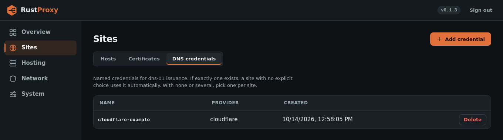
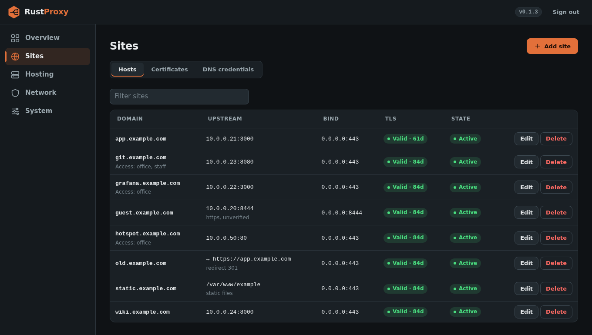

# Getting started

This walks you from a fresh Debian or Ubuntu host to a working HTTPS
site behind rust-proxy. It takes about ten minutes.

## Before you start

- A Linux host with systemd and nftables, with ports 80 and 443 reachable from where your visitors are.
- A domain name whose DNS you control, pointed at this host.
- For dns-01 certificates (and any wildcard), an API credential for your DNS provider. For http-01 you need none, but port 80 must be reachable from the internet.

## 1. Install

```sh
sudo mkdir -p /etc/apt/keyrings
sudo curl -fsSL https://repo.jpps.us/repo-signing-key.asc -o /etc/apt/keyrings/jpps-repo.asc
echo 'deb [signed-by=/etc/apt/keyrings/jpps-repo.asc] https://repo.jpps.us/stable /' | sudo tee /etc/apt/sources.list.d/jpps.list
sudo apt update
sudo apt install rust-proxy
```

The repo is GPG-signed, and `apt update` verifies it against the key you
just fetched. The package creates the `rust-proxy` system user, installs
a working default `/etc/rust-proxy/config.toml`, and starts the service.
Check it with:

```sh
systemctl status rust-proxy
```

If it is not running, `sudo systemctl enable --now rust-proxy`.

You can also download a release `.deb` from the project's Releases page
and `dpkg -i` it, or [build from source](deployment.md).

## 2. Run the first-run wizard

Open `http://<host-ip>:8084/`. A new instance has no accounts, so it takes
you straight to a setup page instead of a login screen. **Whoever completes
that page first becomes the instance's admin (the owner).** On a fresh
install the admin UI listens on `0.0.0.0:8084` and the firewall leaves that
port open to any source, which is what lets the wizard work with no config
edits. That also means anyone who can reach the port could claim the admin
account before you do, so open the page right after installing, and finish
it in one sitting. Once an admin exists the setup page is gone for good and
the same address shows the normal login.

There is no default password. The wizard asks you to choose:

- the admin username and password (stored in the runtime database, not the config file),
- the ACME contact email,
- **who may reach the admin page**: a list of IPs or CIDRs enforced in nftables, with an "Add my address" button, and whether to expose the admin port through the firewall at all,
- optionally, a DNS credential.

A list that leaves out your own address is refused, so you cannot lock
yourself out. Admins can change both settings later under Network,
Firewall settings. If `admin.allowed_ips` or `admin.expose_admin_port` is
set in `config.toml`, that value wins and the wizard leaves it alone.

If you leave the list empty the admin port stays open to any source, so
set it. To reach the UI only through an SSH tunnel instead, turn off
"Expose the admin port through the firewall" and use
`ssh -L 8084:127.0.0.1:8084 you@host`, then browse to `http://127.0.0.1:8084/`.

Prefer to keep the admin identity in `config.toml`? See
[Configuration](configuration.md#admin-identity-in-configtoml).

## 3. Add a DNS credential (dns-01 only)

Skip this if you will use http-01. Otherwise, add one under "DNS
credentials" in the admin UI. [Configuration](configuration.md#dns-providers)
lists what each provider needs. The one thing to get right is permission
scope: the token must be able to create and delete TXT records in the
zone.



## 4. Add your first host

On Sites, Hosts, click **Add site**:

1. **Site type:** leave **Web app** selected. The other types are
   **Redirect**, **Static files** and **Maintenance / 404**, and each shows
   only the fields it needs.
2. **Domain:** `app.example.com`.
3. **Send traffic to (upstream):** `127.0.0.1:8000`, the internal service as `host:port`.
4. Under **HTTPS certificate**, leave **Auto-SSL (ACME)** checked and pick how
   to prove you own the domain (**Automatic** is a good default). For the DNS
   check, choose the credential from step 3.
5. Click **Add site**. If the firewall changes, RustProxy shows you the
   change first (see [Firewall](firewall.md#checking-a-change-before-saving));
   confirm it to save.

Each section has a ⓘ link, and each page a **Guide** button, that opens the
matching page of the RustProxy wiki. **Copy** on a site's row starts a new
site with the same settings.

The certificate is requested in the background and renewed
automatically. The same thing through the API, with a token (see
[API](api.md)):

```sh
curl -X POST https://proxy.example.com/api/hosts \
  -H "Authorization: Bearer rpx_..." \
  -H 'Content-Type: application/json' \
  -d '{"domain":"app.example.com","bind_ip_v4":"10.0.0.2","bind_port":443,
       "upstream":"127.0.0.1:8000","websockets":true}'
```



## 5. Check it works

```sh
curl -I https://app.example.com/
journalctl -u rust-proxy --no-pager | tail -20
```

The journal shows each listener it opened and the ACME order progress.
If the certificate does not appear, see [Troubleshooting](troubleshooting.md).

## Where things live

| What | Where |
|------|-------|
| Config | `/etc/rust-proxy/config.toml` |
| State (sqlite) | `/var/lib/rust-proxy/rust-proxy.db` |
| Certificates | `/var/lib/rust-proxy/certs/<domain>/` |
| ACME account key | `/var/lib/rust-proxy/acme-account.key` |
| Logs | `/var/lib/rust-proxy/` (`proxy.log`, `access.log`, `server.log`) and the journal |
| Nightly DB backups | `/var/lib/rust-proxy/backups/`, written at 03:00 by `rust-proxy-backup.timer`, 14 days kept |

The `hosts` and `port_rules` in `config.toml` only seed an empty database
on first boot. After that, the database is the source of truth and you
manage everything from the UI or API.

## Next steps

- Restrict who can reach a host: [Access control](access-control.md).
- Send blocked visitors somewhere useful: [deny_fallback](deny-fallback.md).
- Coming from NPM: [Migration guide](migration-from-npm.md).
