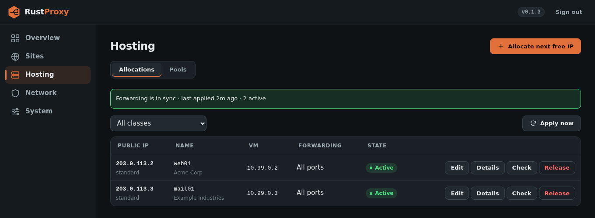

# Public-address hosting

An optional feature for turning a routed block of public addresses (for
example a /28) into **1:1 forwards to private customer VMs**. Each
customer VM gets its own public IP and a private address behind the host.
Nothing happens until you create a pool.

## Concepts

- A **pool** is a class of address space: a public CIDR, a private VM network, and a gateway. `standard` and `ham` are just names you choose.
- An **allocation** assigns one public address from a pool to one VM, with the next free private address. Allocating also hands back provisioning hints for configuring the VM.
- `forward` is `"all"` (every protocol and port) or `"ports"` with a `ports` list.



## Create a pool

```sh
curl -X POST http://127.0.0.1:8084/api/hosting/pools \
  -H "Authorization: Bearer $TOKEN" -H 'Content-Type: application/json' \
  -d '{"name":"standard","cidr":"204.52.221.224/28","reserved":["204.52.221.225"],
       "vm_cidr":"172.16.63.0/24","gateway":"172.16.63.1"}'
```

`reserved` lists public addresses that must never be handed out (the
router's own address, for example).

Pools can also be pre-created on first start, only when the database has
none:

```toml
[[hosting.pools]]
name     = "standard"
cidr     = "204.52.221.224/28"
vm_cidr  = "172.16.63.0/24"
gateway  = "172.16.63.1"
```

## Allocate an address

```sh
curl -X POST http://127.0.0.1:8084/api/hosting/allocations \
  -H "Authorization: Bearer $TOKEN" -H 'Content-Type: application/json' \
  -d '{"class":"standard","name":"web01","customer":"Acme"}'
```

`pool` is accepted as an alias for `class`. Add `public_ip` to ask for a
specific address from the pool; leave it out and the lowest free one is
used. `notes` is free text.

The response's `provision` object carries what to configure on the VM:
`private_ip`, `gateway`, `netmask`, `cidr` and `ipconfig0` (a ready-made
Proxmox cloud-init value).

## Other endpoints

| Method | Path | Purpose |
|--------|------|---------|
| GET, POST | `/api/hosting/pools` | List or create pools |
| PUT, DELETE | `/api/hosting/pools/:name` | Update or remove a pool |
| GET, POST | `/api/hosting/allocations` | List or create allocations |
| GET, PATCH, DELETE | `/api/hosting/allocations/:id` | Read, change or release one |
| POST | `/api/hosting/allocations/:id/check` | Verify the live state of one allocation |
| GET | `/api/hosting/status` | Per-pool usage and the last apply |
| POST | `/api/hosting/apply` | Re-apply the network configuration now |

## How it is applied

- A `/32` on `lo` per active allocation.
- A blackhole route per pool, so unallocated addresses stay silent.
- An `ip rust_proxy_hosting` nftables table with DNAT inbound and SNAT outbound.
- A guard that drops non-ICMP traffic still addressed to a hosted IP, and a rule that keeps VMs off private networks.

The `inet rust_proxy` table and any router table are never modified, so
the host's forward policy must also accept the VM network. The feature
needs `CAP_NET_ADMIN`, plus `CAP_NET_RAW` for the single ICMP ping the
reachability check sends (the packaged unit grants both).

Addresses listed in `network.dedicated_ips`, or already bound to a host
or port rule, cannot be hosted.

## Security note

Hosting forwards public traffic straight to customer VMs, so anything
running on a hosted address is directly exposed. The VM, not the proxy,
is responsible for its own firewalling.
