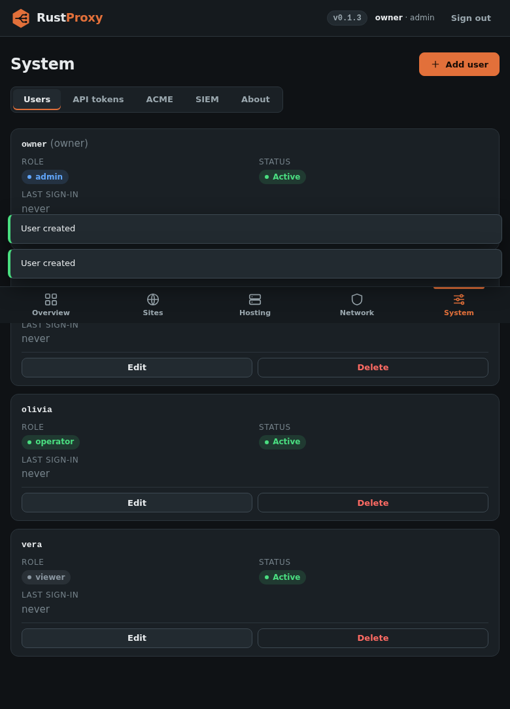

# Users and roles

rust-proxy's admin UI and API support more than one account. Every
account, API token and client certificate that reaches the admin API has
one of three roles.



## The owner

The account created by the first-run wizard, or set in `config.toml` (see
[Configuration](configuration.md#admin-identity-in-configtoml)), is the
**owner**. The owner:

- is always an admin;
- is shown first in the Users tab and cannot be edited, disabled or deleted there;
- changes their password through the wizard's stored credential or `config.toml`, not through the Users tab.

Because the owner cannot lose the admin role, a mistake in the Users tab
can never lock everyone out.

## Roles

| Role | What it can do |
|------|----------------|
| `admin` | Everything. |
| `operator` | Reads every page and changes proxy configuration: hosts, port rules, access lists, certificates and hosting allocations. |
| `viewer` | Reads every page except Users and API tokens. Cannot change anything. |

Some areas are admin-only so that an operator cannot widen their own access:

| Area | Admin | Operator | Viewer |
|------|-------|----------|--------|
| Users (`/api/users`) | read, write | none | none |
| API tokens (`/api/tokens`) | read, write | none | none |
| DNS credentials, ACME settings, firewall settings, SIEM, hosting pools | read, write | read | read |
| Everything else (hosts, port rules, ACLs, certificates, allocations) | read, write | read, write | read |

In the web UI, pages a role cannot use are hidden, and a viewer sees the
rest in read-only mode. The API enforces the same rules whatever the UI
shows.

## Adding a user

In the Users tab choose **Add user**, enter a username, a password of at
least 8 characters and a role. Usernames are 1 to 64 characters of
letters, digits, `.`, `_`, `@` and `-`, and are case-insensitive: `Adam`
and `adam` are the same account, and nobody can reuse the owner's name.

Or through the API:

```sh
curl -b /tmp/cookies -X POST https://proxy.example.com/api/users \
  -H 'Content-Type: application/json' \
  -d '{"username":"adam","password":"a-long-password","role":"operator"}'
```

From the Users tab an admin can also change a user's role, disable or
re-enable them, reset their password, or delete them.

## Changes take effect immediately

The session cookie only proves who signed in. The role is read from the
database on every request. When an admin changes a role, disables a user
or deletes one, that user's next request is already subject to the change,
even though their cookie is still valid for up to 12 hours.

## Changing your own password

Every signed-in database user can change their own password from the
**Change password** button in the header (`POST /api/me/password`, which asks
for the current password). The owner, API tokens and client certificates
have no stored password to change here.

## API tokens and roles

A token is minted with a role (see [API](api.md#tokens)) and is limited by
it exactly like a user. The default is `admin`, which is what every token
was before roles existed, so existing tokens keep working. For a script that
only reads, mint a `viewer` token; for a deployment pipeline that changes
hosts, an `operator` token. A client certificate used to reach the admin API
is treated as an admin.

## Audit trail

The access log and the SIEM `admin_*` events record the `user` and `role`
of each request (a token appears as `token:<name>`, a certificate as
`cert:<subject>`). A request the role does not allow returns `403` and
emits an `admin_access_denied` event; see
[Logging and SIEM](logging-and-siem.md).
